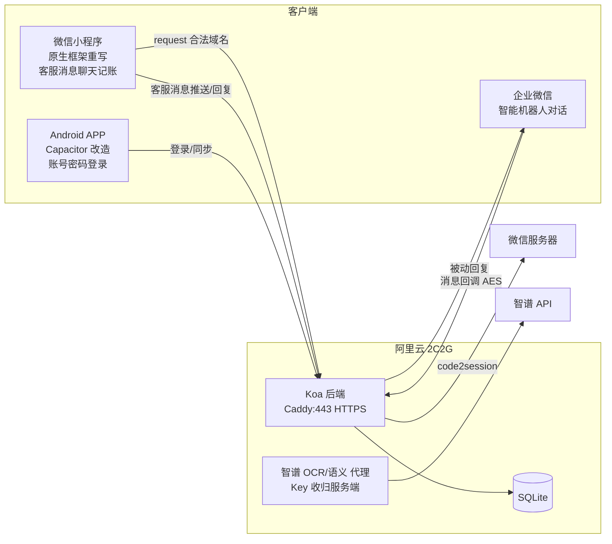

# 简记上线路线方案：微信小程序 + 聊天机器人记账 + APP 同步

> 版本：v2.1（2026-10-21）· 状态：待审核，未开工
> v2 变更：根据四项决策更新主体/登录/迁移/机器人方案；新增"非团队成员可用性"专项分析
> v2.1 变更：否决"客户联系单聊回调"与"微信客服"路径（均需付费/企业认证），非成员聊天记账改用**小程序客服消息回调**

---

## 一、已确认的决策

| # | 决策点 | 结论 |
|---|---|---|
| 1 | 小程序主体 | **个人主体**（个人主体功能足够：无支付、无 web-view 需求；提审类目：工具-效率） |
| 2 | APP 登录 | **账号 + 密码**（服务端建账号表，10 人内部用户，不做短信验证） |
| 3 | 旧数据迁移 | **不做**。正式启用后从零开始记账 |
| 4 | 机器人可达范围 | **需对非企微成员开放** → 已评估三条路径（见第三节），最终组合：企微机器人（成员）+ 小程序客服消息（所有微信用户） |

资源条件：阿里云 2核2G/40G（大陆节点，域名备案中）· 微信小程序个人主体 · 企业微信个人注册（未认证团队）

---

## 二、目标架构

各端职责：
- **小程序**：官方原生框架（WXML/WXSS/JS）重写四页：明细 / 统计 / 记一笔 / 设置；内置**客服会话入口**（聊天记账，对所有人开放）；`data.js` 的账单 CRUD/统计逻辑平移复用
- **后端（全新搭建）**：账单 API、登录鉴权、三端同步、企微回调、OCR/语义解析代理
- **APP**：从纯本地改造为"本地缓存 + 服务端同步"，离线可记账，联网合并
- **企微机器人**：成员聊天框输入"打车 35"→ 后端调 LLM 解析入库 → 回复确认

---

## 三、专项分析：非团队成员如何"聊天记账"

**硬限制**：企业微信机器人只能给已加入该企微组织的成员发消息。要触达普通微信用户，三条路径均已查证官方文档与开发者社区案例：

| 路径 | 结论 | 原因 |
|---|---|---|
| 客户联系：微信用户加企微成员为好友，单聊消息回调后端 | ❌ 否决 | 单聊消息的实时回传依赖「会话内容存档」——付费增值服务（约 ¥200–600/账号/年）、需企业认证与资质审核，未认证个人组织无法开通 |
| 微信客服（kf 账号）：微信用户点链接即聊 | ❌ 否决 | 体验理想，但官方要求**企业认证后才能配置消息回调 URL**，未认证组织配置时直接报"回调域名校验失败" |
| **小程序客服消息回调** | ✅ 推荐 | 官方知识库确认**个人主体小程序支持客服消息接口**；免费、无需认证。用户在小程序客服会话（微信原生聊天界面）发"打车 35"→ 推送到后端 → LLM 解析入库 → 客服接口回复确认 |

**最终组合：企微智能机器人（服务成员，含扫码加入的熟人）+ 小程序客服消息（服务所有微信用户，零门槛）**。两条入口在后端共用同一条"LLM 解析 → 入库"管线，只写一次代码。若企微智能机器人对未认证组织不可用（R2），由客服消息单独承担；若客服消息实测也受限，备选个人订阅号被动回复。

**客服消息技术要点**：
- 小程序内放 `<button open-type="contact">` 入口进入客服会话，界面即微信原生聊天框，无需自建对话 UI
- **回访入口**：用过一次后，微信聊天列表出现「小程序客服消息」聚合盒子，点入即可查看历史并继续发消息记账，无需重开小程序；另可配合「我的小程序」（首页下拉）与 Android 桌面快捷方式
- mp 后台「开发→开发设置→消息推送」配置服务器 URL + Token + EncodingAESKey（建议兼容模式）
- 回复走「发送客服消息」接口，须在用户发送后 48 小时内（记账即时回复，完全够用）
- 文本消息推送格式与公众号类似（XML + 签名校验），后端与企微回调分路由处理

---

## 四、执行阶段

| 阶段 | 内容 | 前置依赖 |
|---|---|---|
| **P0 准备与验证** | ① 注册个人主体小程序，拿 AppID；② 注册企微（个人可建未认证团队），**立即实测智能机器人回调是否可用**（R2 验证项，不通过则由小程序客服消息单独承担）；③ 推进备案；④ 服务器装 Node + Caddy | 备案是正式上线的硬阻塞，越早提交越好 |
| **P1 后端** | Koa + SQLite + JWT；账单 CRUD / 按月查询 / 增量同步接口（幂等 UUID，最后写入胜出，软删除）；账号密码登录 + 小程序 `code2session` 自动注册绑定 openid；智谱 API 代理（Key 移入服务端环境变量） | 服务器即可，IP 联调 |
| **P2 小程序** | 原生框架重写明细/统计/记一笔/设置；主题用语义 CSS 变量平移；`data.js` 逻辑改造为 `wx.request` + `wx.setStorageSync` 缓存；客服会话入口按钮 | P1 |
| **P3 聊天记账接入** | ① 企微智能机器人回调（AES-CBC 加解密 + echostr 验证）；② 小程序客服消息推送（mp 后台配置 URL/Token，接收 → LLM 解析 → 入库 → 客服接口回复确认）；两条入口共用解析管线 | P1 + 备案完成（80/443 未备案域名会被阿里云拦截，可先内网穿透通流程） |
| **P4 APP 改造** | 登录页（账号密码）；启动增量同步；本地写入即上报；确认弹窗沿用自定义对话框（无 `prompt()`/`confirm()`） | P1 |
| **P5 发布** | 体验版 10 人内测 → 备案下来配置合法域名 → 提审上线 | 备案 |

---

## 五、技术要点

1. **三端同一身份**：账号表（username + password_hash + openid 可空）。小程序首启 `wx.login` → `code2session` 自动建号绑定 openid；APP/企微场景走账号密码或团队通讯录身份。同一账本默认全员共享（家庭账本模式），如需隔离再加账本组概念。
2. **同步协议**：客户端生成 UUID 作主键；同步接口仅 upsert；字段含 `updated_at`、`deleted`（软删除）；APP 端 localStorage 作离线缓存，联网按 `updated_at` 增量拉。10 人规模不做冲突合并，最后写入胜出。
3. **聊天记账统一管线**：企微智能机器人（注意不是只能发的「群机器人 webhook」）与小程序客服消息两条入口，回调解密/验签后走同一管线：调智谱（复用现有 prompt，注入服务器当前时间解决"昨天/今天"推断）→ 金额/分类校验 → 入库 → 回复"✅ 已记：打车 ¥35.00（10-21）"。客服消息回复须在用户消息后 48h 内。
4. **HTTPS**：Caddy 自动签发 Let's Encrypt；2C2G 跑 Koa + Caddy + SQLite 内存约 200MB。
5. **数据安全**：智谱 Key 移到服务端（修复当前前端硬编码泄露）；SQLite 每日 cron 备份。
6. **小程序侧已知约束**：无 `prompt()`/`confirm()`（与 Capacitor 教训一致，沿用自定义弹窗）；脚本无浏览器缓存问题，无需 `?v=` 参数；主包控制在 2MB 内（无大资源，无压力）。

---

## 六、风险清单

| # | 风险 | 等级 | 应对 |
|---|---|---|---|
| R1 | 备案周期拖延（1–3 周） | 中 | P0 立即提交；期间完成 P1/P2 开发，体验版开调试模式可测 |
| R2 | **未认证企微组织的智能机器人回调可能受限**（文档未明确保证） | 中 | P0 第一时间实测；不可用则由小程序客服消息单独承担（已确认个人主体支持），备选个人订阅号 |
| R3 | 小程序 UI 全量重写（最大工作量） | 高（工作量） | 逻辑层复用、UI 按现有设计稿重写；无技术攻关，纯工作量 |
| R4 | 个人主体提审被拒 | 低 | 工具-效率类目、无敏感功能；记账工具过审案例充分 |
| R5 | 客服消息 48h 回复窗口 / 订阅号 5s 被动回复限制 | 低 | 记账均为即时回复，不受影响；订阅号备选需超时兜底文案，账单不丢 |
| R6 | LLM 解析失败（含糊表达） | 低 | 失败时回复引导示例文案；解析成功入库前做金额/分类校验 |

---

## 七、可行性结论

**可行，无技术攻关项，主要制约是备案周期。**
- 10 用户、日均几十条账单：QPS 峰值 < 5，SQLite 年数据量 < 10MB，2C2G 余量巨大。
- 全链路（原生小程序、Koa、SQLite、企微回调、LLM 解析）均为成熟方案。
- 新增成本为零：个人小程序/企微/订阅号/Let's Encrypt 均免费，智谱 API 按量几元级。
- 最大不确定性 R2（未认证企微机器人可用性）已有降级路径，不阻塞整体上线。

---

## 八、开工前置清单（确认后执行）

- [ ] 注册个人主体小程序 → 拿到 AppID
- [ ] 注册企微未认证团队 → 实测智能机器人回调（R2 验证）
- [ ] 域名备案提交/推进中
- [ ] 服务器 SSH 可达，安装 Node 20 + Caddy
- [ ] （可选）注册个人订阅号作为 B 方案备份
